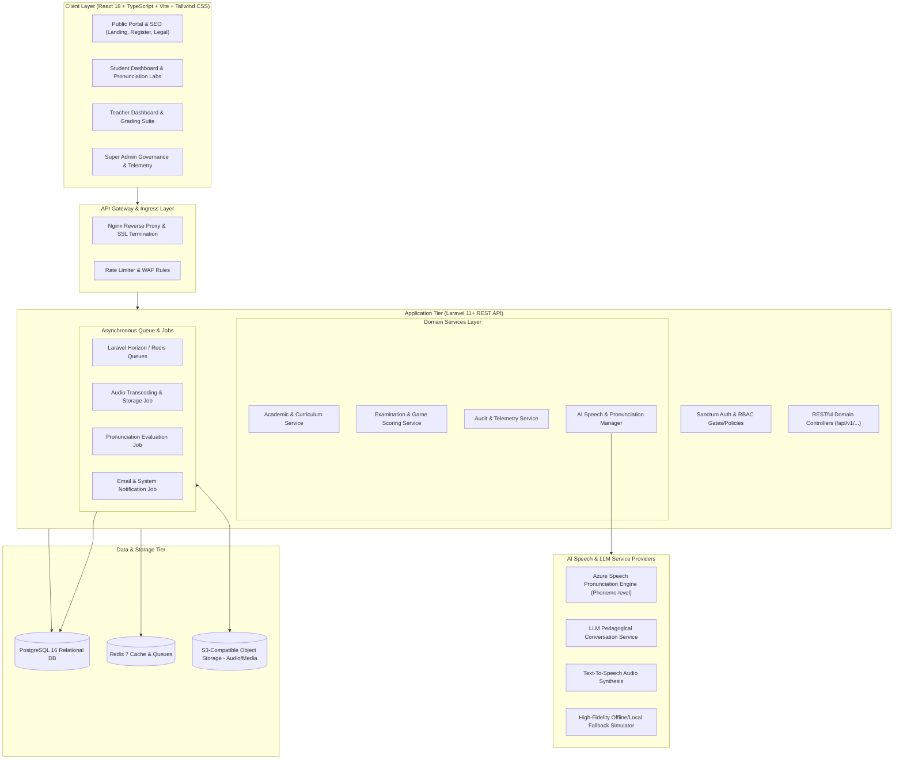
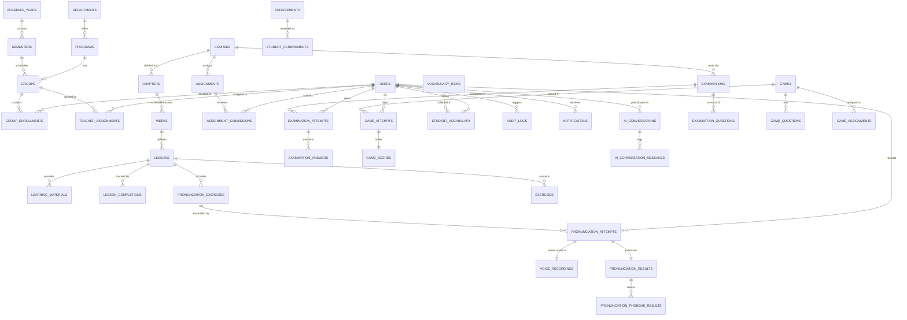

# PHONETIX — Institutional English Phonetics LMS
## Enterprise Architecture & Technical Specification Document

---

### 1. Executive Summary & Architecture Overview

**PHONETIX** is an enterprise-grade institutional English Phonetics Learning Management System (LMS) designed for colleges, universities, and language centers. It delivers an AI-powered phonetic assessment and conversational ecosystem connecting three dedicated stakeholder environments:
1. **Super Administrator:** Enterprise governance, multi-campus academic structure, user lifecycle & approval workflows, curriculum scheduling, audit logging, and system health telemetry.
2. **Teacher / Faculty:** Class group management, lesson delivery, assignment/examination creation, audio recording review, phoneme weakness analytics, and academic grading.
3. **Student:** Interactive learning path, Web Audio-based Interactive IPA Chart, AI Pronunciation Laboratory (phoneme-level assessment), AI Conversational Speaking Partner, Educational Game Engine, Vocabulary Notebook, and portfolio tracking.



---

### 2. Multi-Tier Technology Stack Specification

| Tier | Component | Technology Selection | Architectural Justification |
| :--- | :--- | :--- | :--- |
| **Frontend** | Framework | **React 18 + TypeScript + Vite** | High-performance bundling, zero runtime type errors, modern component paradigm. |
| | UI & Styling | **Tailwind CSS + Shadcn/UI primitives** | Consistent design tokens, custom accessibility, responsive breakpoints, zero CSS bloat. |
| | State & Cache | **TanStack Query v5 + Zustand** | Optimistic UI updates, server-state caching, minimal re-renders. |
| | Audio & Voice | **Web Audio API + MediaRecorder** | In-browser real-time waveform visualization, raw PCM/WAV capture, zero vendor lock-in. |
| | Icons & Charts | **Lucide Icons + Recharts** | Tree-shakeable SVG iconography and responsive institutional analytics. |
| **Backend** | Framework | **Laravel 11+ (PHP 8.2+)** | Battle-tested enterprise framework, robust ORM (Eloquent), first-class queue and event system. |
| | Security | **Laravel Sanctum + Policies** | Token and cookie-based stateless authentication with strict multi-tenant role enforcement. |
| | Background Jobs| **Laravel Horizon + Redis** | Reliable async audio processing, notification dispatch, and scheduled academic tasks. |
| **Database** | Primary RDBMS | **PostgreSQL 16** | Strict relational integrity, foreign key cascading, JSONB support for phonetic scores. |
| | Cache & Broker | **Redis 7** | Sub-millisecond caching, rate limiting tokens, and high-throughput job queues. |
| **Object Storage**| Media Store | **S3-compatible Object Storage (MinIO / AWS S3)** | Prevents database bloat by keeping heavy audio WAV/MP3 files out of PostgreSQL. |
| **AI Speech** | Assessment | **Azure AI Speech Pronunciation Assessment API** | Phoneme-level scoring (accuracy, fluency, completeness, prosody). |
| | LLM Tutor | **OpenAI / Claude / Gemini API Integration** | Socratic conversational partner tailored to CEFR A1-C2 English proficiency levels. |
| | Fallback Engine| **Native Pedagogical Simulation Engine** | Guarantees testability and local operation when external cloud keys are absent. |

---

### 3. Enterprise Relational Database Schema (42+ Entities)



#### Key Database Entities Specification

1. **`users`**: `id`, `institutional_id`, `first_name`, `last_name`, `email`, `personal_email`, `phone`, `password`, `role` (`super_admin`, `teacher`, `student`), `status` (`pending`, `active`, `suspended`, `rejected`), `approved_by`, `approved_at`, `avatar_url`, `two_factor_secret`, `preferences`, `created_at`, `updated_at`, `deleted_at`.
2. **`academic_years`**: `id`, `name` (e.g. "2026-2027"), `start_date`, `end_date`, `is_current`, `created_at`.
3. **`semesters`**: `id`, `academic_year_id`, `name` (e.g. "Fall 2026", "Spring 2027"), `semester_number`, `start_date`, `end_date`.
4. **`departments`**: `id`, `name` (e.g. "Department of English & Applied Linguistics"), `code`, `head_name`, `description`.
5. **`programs`**: `id`, `department_id`, `name` (e.g. "BA in English Language & Literature"), `code`, `degree_level` (`undergraduate`, `postgraduate`).
6. **`groups`**: `id`, `program_id`, `semester_id`, `name` (e.g. "Group A1", "Group B2"), `academic_year_id`, `capacity`, `is_active`.
7. **`group_enrollments`**: `id`, `group_id`, `student_id`, `status` (`active`, `transferred`, `completed`), `enrolled_at`.
8. **`teacher_assignments`**: `id`, `teacher_id`, `group_id`, `course_id`, `academic_year_id`, `is_primary`.
9. **`courses`**: `id`, `code` (e.g. "ENG-101"), `title` ("English Phonetics & Oral Communication"), `department_id`, `credits`, `description`, `syllabus_url`, `thumbnail_url`, `is_published`.
10. **`chapters`**: `id`, `course_id`, `order_number`, `title` ("Introduction to Vowels"), `description`, `learning_objectives`, `is_locked`, `published_at`.
11. **`weeks`**: `id`, `chapter_id`, `week_number`, `title`, `start_date`, `end_date`.
12. **`lessons`**: `id`, `week_id`, `chapter_id`, `order_number`, `title`, `content_body`, `video_url`, `audio_url`, `duration_minutes`, `is_published`.
13. **`learning_materials`**: `id`, `lesson_id`, `title`, `file_type` (`pdf`, `docx`, `pptx`, `audio`, `video`), `file_path`, `file_size_bytes`, `download_allowed`.
14. **`pronunciation_exercises`**: `id`, `lesson_id`, `target_text`, `ipa_transcription`, `audio_sample_url`, `difficulty` (`beginner`, `intermediate`, `advanced`), `explanation`, `target_phonemes` (JSONB).
15. **`voice_recordings`**: `id`, `user_id`, `storage_path`, `duration_seconds`, `sample_rate`, `file_size_bytes`, `audio_format` (`wav`, `webm`, `mp3`), `consent_acknowledged_at`.
16. **`pronunciation_attempts`**: `id`, `exercise_id`, `student_id`, `voice_recording_id`, `attempt_number`, `created_at`.
17. **`pronunciation_results`**: `id`, `attempt_id`, `overall_score`, `accuracy_score`, `fluency_score`, `completeness_score`, `prosody_score`, `assessed_by_provider` (`azure`, `mock`, `teacher_manual`), `raw_provider_response` (JSONB), `feedback_text`.
18. **`pronunciation_phoneme_results`**: `id`, `result_id`, `phoneme`, `ipa_symbol`, `score`, `status` (`correct`, `acceptable`, `needs_improvement`, `omitted`, `inserted`), `start_offset_ms`, `end_offset_ms`, `suggestion`.
19. **`ai_conversations`**: `id`, `student_id`, `title`, `cefr_level` (`A1`, `A2`, `B1`, `B2`, `C1`), `topic`, `duration_seconds`, `summary`, `status` (`active`, `completed`).
20. **`ai_conversation_messages`**: `id`, `conversation_id`, `sender_role` (`student`, `ai_tutor`), `content`, `audio_url`, `grammar_feedback` (JSONB), `pronunciation_notes` (JSONB).
21. **`games`**: `id`, `title`, `type` (`sound_recognition`, `minimal_pairs`, `ipa_challenge`, `phonetic_transcription`, `stress_challenge`, etc.), `difficulty`, `time_limit_seconds`, `passing_score`, `rules_json` (JSONB).
22. **`game_questions`**: `id`, `game_id`, `prompt_text`, `audio_prompt_url`, `options_json` (JSONB), `correct_answer_json` (JSONB), `explanation`, `points`.
23. **`game_attempts`**: `id`, `game_id`, `student_id`, `score`, `is_passed`, `time_spent_seconds`, `answers_json` (JSONB).
24. **`assignments`**: `id`, `course_id`, `teacher_id`, `title`, `description`, `due_date`, `max_score`, `target_groups` (JSONB), `is_published`.
25. **`assignment_submissions`**: `id`, `assignment_id`, `student_id`, `audio_recording_id`, `text_submission`, `file_path`, `score`, `teacher_feedback`, `graded_by`, `graded_at`.
26. **`examinations`**: `id`, `course_id`, `title`, `duration_minutes`, `passing_score`, `randomize_questions`, `starts_at`, `ends_at`, `is_published`.
27. **`examination_attempts`**: `id`, `examination_id`, `student_id`, `score`, `is_graded`, `started_at`, `submitted_at`.
28. **`vocabulary_items`**: `id`, `word`, `ipa_transcription`, `part_of_speech`, `audio_url`, `definition`, `example_sentence`, `phonetic_breakdown` (JSONB).
29. **`student_vocabulary`**: `id`, `student_id`, `vocabulary_item_id`, `personal_notes`, `mastery_level` (`learning`, `familiar`, `mastered`), `last_practiced_at`.
30. **`achievements`**: `id`, `badge_code`, `title`, `description`, `icon_url`, `criteria_type`, `criteria_threshold`.
31. **`student_achievements`**: `id`, `student_id`, `achievement_id`, `awarded_at`.
32. **`notifications`**: `id`, `user_id`, `type`, `title`, `message`, `action_url`, `is_read`, `created_at`.
33. **`audit_logs`**: `id`, `user_id`, `ip_address`, `user_agent`, `action`, `entity_type`, `entity_id`, `old_values` (JSONB), `new_values` (JSONB), `created_at`.
34. **`system_settings`**: `id`, `key`, `value`, `category` (`branding`, `ai`, `academic`, `security`, `email`), `is_encrypted`, `updated_at`.

---

### 4. Visual Design System & Brand Identity Specification

* **Primary Navy:** `#14243B` (Authoritative institutional stability)
* **Secondary Royal Blue:** `#2563EB` (Dynamic academic engagement)
* **Refined Violet Accent:** `#7657E8` (Modern AI & Phonetics precision)
* **Background Light:** `#F5F7FB` | **Background Dark:** `#0B132B`
* **Surface Light:** `#FFFFFF` | **Surface Dark:** `#131F37`
* **Success:** `#16A36A` | **Warning:** `#E5A23B` | **Destructive / Error:** `#DC5252`
* **Typography:** `Inter`, system-ui, -apple-system, sans-serif.
* **WCAG 2.2 AA Contrast Compliance:** All text tokens maintain minimum 4.5:1 contrast against surface backgrounds; key buttons reach > 7:1.

---

### 5. Implementation Roadmap (Phases 1 through 10)

```mermaid
gantt
    title PHONETIX Master Implementation Roadmap
    dateFormat  YYYY-MM-DD
    section Phase 1 to 5
    Phase 1: Architecture, Scaffolding, Design System & Containers :active, 2026-11-10, 2026-11-11
    Phase 2: Core Authentication, RBAC & Approval Workflow        :2026-11-11, 2026-11-12
    Phase 3: Academic Structure & Curriculum Management           :2026-11-12, 2026-11-13
    Phase 4: Student & Teacher Dashboards                         :2026-11-13, 2026-11-14
    Phase 5: Educational Games & Examination Engine               :2026-11-14, 2026-11-15
    section Phase 6 to 10
    Phase 6: AI Pronunciation Lab (Phoneme Assessment)           :2026-11-15, 2026-11-16
    Phase 7: AI Speaking Partner (Conversational Tutor)           :2026-11-16, 2026-11-17
    Phase 8: Analytics, Telemetry & Export Engine                 :2026-11-17, 2026-11-18
    Phase 9: Enterprise Security, Cache & Load Optimization       :2026-11-18, 2026-11-19
    Phase 10: Production Readiness, Compliance & Verification     :2026-11-19, 2026-11-20
```
